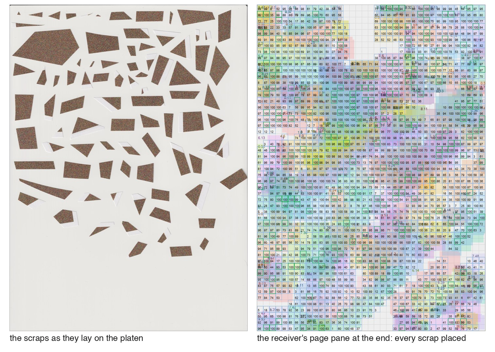
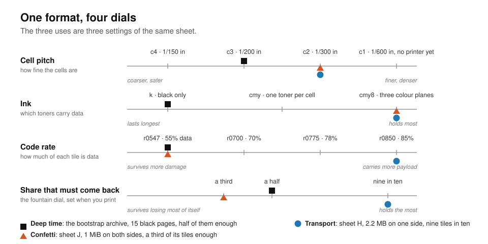
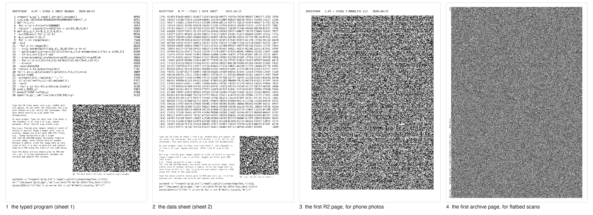
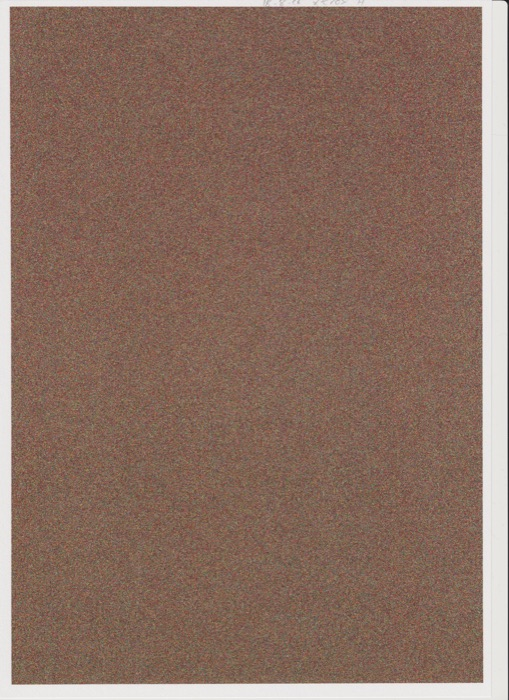
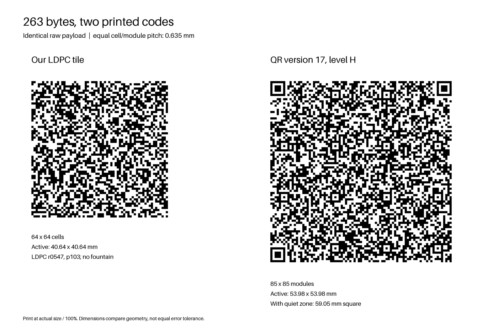
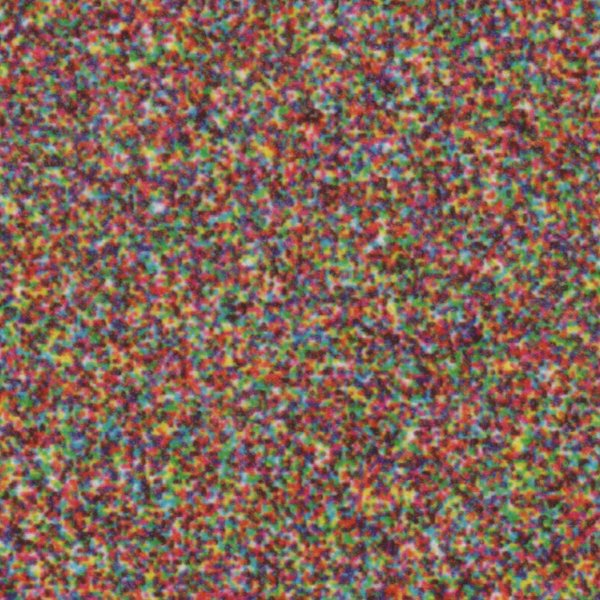

# Print your file. Read it back from whatever is left.

**Files on ordinary paper, from a laser printer to a flatbed scanner: for deep time, for recovery from scraps, and for moving megabytes with no network in between.**

paper-store prints a file as thousands of tiny tiles, each carrying its own address. There are no finder squares, no frame and no header. Enough tiles from the same archive, in any order, rebuild the file. When you print, you choose how many of them have to survive. Spend more of the sheet on that and it tolerates more missing paper. Spend less and it holds more bytes.

- **Printed dense.** In the extreme, one side of A4 holds 2.2 MB uncompressed. Fragile to anything and everything, but a practical, measured number.
- **Printed to survive.** By turning up redundancy and addressability you can, aspirationally, shred (P-1 to P-4) sheets and still recover them. A sheet carrying 1 MiB went through a paper cutter into hundreds of pieces and was recovered.
- **Printed for deep time.** Type 28 lines from a printed listing, and the paper teaches a computer with nothing but Python to read the rest. That chain bootstraps the release source tree from nothing.



*Sheet J. Left: loose scraps on the flatbed. Right: every scrap placed, green where its address decoded. Nobody sorted them. [The experiment](experiments/035-sheet-j-confetti.md).*

Think of the sheet as a radio link across time and space. The printer transmits, the paper is the channel, the scanner receives, and the propagation delay can be measured in decades. So the reader is built like a radio receiver, not a file parser: it locks onto the grid by itself, weighs every cell as a probability, and treats what is missing as gaps to fill. [The talk](docs/paper-channel-workshop.html) that set that frame is the July 2026 design in slides.

## The format's levers

One object, four levers. A tile certifies or it does not. The format id sets how fine the cells are, which toners carry data and how much of each tile is error correction, and the fountain dial, set when you print, decides what share of the sheet must come back. Black against colour is durability against bytes. The three uses are three settings of the same sheet, and the bootstrap stands in front of them: a reader printed on the paper.



*Cell pitch, ink, code rate, and the share of the sheet that must come back: four dials, and the three uses are three settings of them. The single-scan result below, sheet I, is sheet H's layout at a lower code rate.*

### Deep time: the paper carries its own reader

A sheet in a drawer needs no power, no vendor and no file system. Black toner is carbon, the pigment of inks still readable on 2,000-year-old manuscripts, fused into the page, and the aim is to keep the files readable for as long as that lasts. The [bootstrap](bootstrap/README.md) prints the means of reading them, and each stage recovers the next:

1. Type the **28-line program** from its listing. Each line carries a check code, and a wrong line names itself.
2. Enter the **data sheet** at its prompt. The program rebuilds a reader for coarse printed marks.
3. That reader takes **two pages of big printed bullseyes**, from a photo or a scan, and produces a 24 KB archive decoder in plain Python, with no imports.
4. The decoder reads the **dense archive pages**, checks the file and unpacks it.



*The listing, the data sheet, a bullseye page, a dense archive page. [The chain on paper](bootstrap/PAPER-2026-10-26.md). Zoom in: the pages are legible.*

### Confetti: no paper jigsaw

Sheet J was printed so that a third of its tiles would be enough. Then it went through a paper cutter. Stripes, squares and triangles went onto the scanner as they fell, both faces, every rotation, nothing matched edge to edge. Each piece named its own place. A tile cut in two was read from both of its halves, and a scrap scanned twice gave two views that together read what one could not. The receiver had its third after about twelve minutes.

### Transport: megabytes with nothing in between

A printer and a scanner move data with nothing between them but a sheet: no cable, no radio, no shared disk. Sheet H holds 2.2 MB on one side, 285 bits per square millimetre, and every tile of it came back. The last tiles took a second reader, the [analyzer](analyzer/README.md), which learns this sheet's ink from the tiles the first reader already trusts: a cyan cell printed under magenta and yellow reads two to four times worse than any other, and a model trained on the certified neighbours read the last 200 tiles, none wrong. The same layout at a lower code rate, sheet I, came back from a single scan: 1.8 MB in about 33 minutes. Black pages have come back from [five different printers](docs/RECORD.md), colour from three. The next target is 4 MB across both sides of a sheet, or exploring if 600 dpi prints can be made to work at all.



*The densest side recovered so far. [The readout](experiments/036-sheet-h-full-readout.md).*

## What makes it work

**An address outlives the bytes on it.** A few scattered marks, under 3% of a tile, have their own error correction, separate from the payload. A scrap can name its place while the data on it is still unreadable, and that place is the tile's index in the file, so the page has no header to find. On the cut-up sheet the address word decoded with up to 13 of its 100 marks wrong, exactly the code's limit, and every scrap was placed in any of four rotations.



*The same 263 bytes at the same cell pitch. The tile is 41 mm square; the QR code is 54 mm, its corners spent on finder marks. A render from [qr-toy](qr-toy/README.md), one enlarged tile to photograph with a phone.*

**The reader finds the grid by itself, and every view counts.** No mark says where the cells are; the receiver finds their lattice in a Fourier transform of the page. Every cell is read as a probability, not a 0 or a 1. Within one scan the best view of each cell is kept, and a second scan's view is added to it before the decoder runs. Tiles that already checked out teach the reader how this printer inks, and the analyzer takes that further, learning the shape of this sheet's ink.

**The code has gears.** A [ladder of LDPC codes](docs/FEC-DESIGN.md), error correction with a rung for every print, spends a tile on surviving damage or on payload when the print is clean. The colour planes can take different rungs, so the weak toner gets more protection. A tile counts only when its code checks and the CRC inside it passes. A rateless fountain code on top of that takes care of missing tiles. The recovered file matches its own SHA-256, or it does not come back.

**The scramble costs no bits and does three jobs.** The payload is XORed with an AES stream of the format and the cell address. That one step flattens the ink so every patch looks like every other, gives every patch the cell lattice the grid finder locks onto, and lets a scrap that has found its place rebuild the stream for its own cells. Which format was used is a short id, and it is not printed on the sheet. Read with the wrong one, every cell is a coin flip. A reader could try candidate layouts until a tile certifies. The [format](docs/HOLO-DESIGN.md) and the [id grammar](docs/FORMAT-SPACE.md) say what there is to try.



*Sheet H at 1200 dpi. No line shows where a tile begins.*

**Tiny programs, serious compression.** Getting the bootstrap onto paper took two compressors. The first is a context-mixing decoder with a big-integer rANS state, 14 lines of Python: the next reader comes back out of one enormous integer, and its model is primed with the program's own printed source. The second, context mixing plus arithmetic coding, a model that blends its predictions, packed the project's source and docs **23% smaller than `xz -9e`**. Both decoders are integer arithmetic with no imported libraries, so a later machine does not need this one. [The compressor shelf](bootstrap/README.md#compressor-shelf).

**Short a few pages? Send a few more.** If a copy arrives with pages missing or unreadable, you do not reprint the file, and you do not need to find out which parts failed. Print a few new pages from the same file and send those. Each one carries a share of every block, so they fill whatever hole arrived. [The fountain](docs/HOLO-DESIGN.md#72-fountain--fountain-v2-block-assignment-revised-1310).

**Colour triples a side.** Cyan, magenta and yellow are three independent data planes, three codewords in every tile, because a scanner has three channels. Black cannot be a fourth: it looks like all three at once, so black is the long-lived ink and colour is the capacity. With enough redundancy, losing a whole toner removes a known share of every block rather than the file. A printer that re-screens overlapping toner, breaking stacked colours into dots of its own, is given an alphabet of one toner per cell instead. That is how an elderly colour printer, a contone engine that re-screens whatever it is given, with its colour planes out of register, returned a 1.1 MB colour page from one scan. [Colour](docs/CMY-DESIGN.md).

## Where it stands

Each result is a real printed end-to-end loop, but with just a handful of printers and environments. The finest pitch, one 600 dpi printer dot per cell, came back on no printer (your 600 dpi laser printer likely cannot place single 600 dpi dots on its own). The sheet-by-sheet results, including what did not come back, are the [record](docs/RECORD.md).

## Try a published scan

An **80 MB download** and a real scan from a Canon office printer. [The first-run guide](docs/HOWTO.md#first-run-decode-a-published-scan) takes a fresh checkout to:

```text
VERIFIED 122892 bytes sha256 930d4d07…
```

That page closed in 97 CPU seconds. No printer or scanner at hand? `scripts/demo.sh` prints, scans and decodes a small volume entirely in software, and a second tool cuts a simulated scan into scraps. Something to photograph? [qr-toy](qr-toy/README.md) makes one 4 cm tile of 263 bytes for your phone. The guide goes on to installation, your own sheets and the analyzer. The software runs on CPython 3.14, gains from the free-threaded build, and the big colour sheets want a 64 GB machine.

The [evidence releases](docs/evidence-archive/TORRENTS.md) hold about 177 GB of scans, print jobs and payloads, by torrent or by individual HTTP download, covering experiments 001 to 042; the newest captures are not in them yet.

## Prior art

Kudos: [Optar](http://ronja.twibright.com/optar/) and [PaperBack](http://ollydbg.de/Paperbak/) did this years earlier and did it well, and both are honest about what a 600 dpi printer can really place. Optar writes each bit as a 3 by 3 dot square, a 200 dpi grid, under a rate-1/2 Golay code, with a printed mesh of crosses to find it by: about 200 kB of file data per A4 page, in black. PaperBack lays 32 by 32 dot blocks at 300 dpi, each with its own CRC and Reed-Solomon code, and its author gives up to 500,000 uncompressed bytes per sheet; the three megabytes it also quotes is C source after its built-in packer. On the same class of printer, sheet H's 2.2 MB in colour on one side is about eleven times Optar's page and four times PaperBack's, and in black alone a paper-store page has held 657 kB, with nothing on the page to find it by. Both were the yardsticks for the July 2026 design. The pursuit here is a page with no frame, recovered from its pieces, that can carry its own reader.

## Read on

- **Use it:** [manual](docs/HOWTO.md), [measured record](docs/RECORD.md), [experiment logs](experiments/) and [evidence downloads](docs/evidence-archive/TORRENTS.md).
- **The format:** [specification](docs/HOLO-DESIGN.md), [format ids](docs/FORMAT-SPACE.md), the [paper-as-channel talk](docs/paper-channel-workshop.html), and the earlier [design](docs/DESIGN.md), [inner code](docs/FEC-DESIGN.md) and [fountain](docs/FOUNTAIN-DESIGN.md).
- **The readers:** receiver [API](src/holo/receiver/docs/API.md) and [schedule](src/holo/receiver/docs/SCHEDULE.md); analyzer [guide](analyzer/README.md) and [design](analyzer/DESIGN.md); the [bootstrap](bootstrap/README.md) and its [ageing notes](bootstrap/r3/AGING-2026-10-20.md).
- **How it was made:** [FOR_HUMANS.md](FOR_HUMANS.md). AI agents wrote the code. A human directed the design and ran the experiments.

## About this repository

A squashed export of a private repository, in two commits: the tree of 2026-09-04, and the tree at release. Commit shas, tags and branch names cited in the documents resolve only in the private repository. Some cited working papers were withheld. Angle-bracket placeholders stand for removed private strings, and "machine N" names a workstation. The [regeneration record](docs/evidence-archive/REGENERATION-2026-10-22.md) and the [reproduction tools](measure/evidence_regen/README.md) say which trees reproduce the published evidence byte-identically. The manual's first run was verified on the exported tree. 

MIT licence, [LICENSE](LICENSE), (c) by Germano Caronni <gec@acm.org> in 2026. Have fun!
