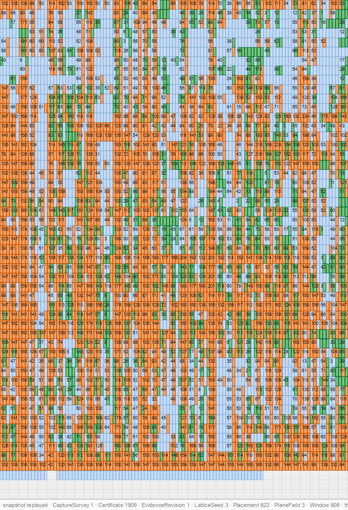

# Print a file. Read it back from whatever is left.

paper-store writes a file onto ordinary paper with an unmodified office laser printer and reads it back from flatbed scans. The page has no finder squares, no frame and no header. It looks like noise, and every part of it looks like every other part. Enough of it, from any page and in any order, rebuilds the file. You decide how much counts as enough when you print. When the file comes back, it checks its own SHA-256.


*Experiment 033's sheet H holds 2,220,921 bytes on one side of one A4 sheet, 284.9 bits per mm² over the whole page, printed on a Xerox AltaLink C8245. The receiver plus the analyzer brought the file back byte-exact from seven flatbed scans. With 13 scans, every one of its 5,883 tile-streams was certified. This is one sheet on one printer, not a success rate.*


*The same scan at 1:1: a 600 by 600 pixel window near the centre of the sheet at 1200 dpi, with the cells of the three planes printed over each other. No mark on the page says where a tile begins. The receiver works that out.*

A workshop talk on the July 2026 design ([docs/paper-channel-workshop.html](docs/paper-channel-workshop.html), an HTML slide deck with July's numbers) puts it in one line: *a printed archive is a communication link across time.* The printer is the transmitter, the scanner is the receiver and the sheet is the channel. So the reading side is built like a radio receiver, not like a file parser. It locks onto the cell grid with no printed frame to help it. It weighs every cell as a probability instead of a 0 or a 1, corrects what it misreads, and treats what is missing as gaps to fill.

## One sheet, three bargains

Density, surviving damage and lasting a long time all spend the same cells. A sheet asked to survive being cut up holds fewer bytes. A sheet asked to hold as much as it can is a sheet you must not lose. One dial, set when you print, decides how much of what you printed has to come back. The unit is the tile-stream: one tile in one colour plane. Sheet H needs 5,277 of its 5,883 tile-streams, about 90%. Sheet J, below, needs 4,020 of 11,766, about a third. The record has a sheet at each end.

### Deep time: the marks are the archive

Paper outlives the drive that wrote it. The case for toner comes from pigment chemistry. Black toner is typically carbon black, the pigment of carbon inks that survive on 2,000-year-old manuscripts, and fused toner seals its pigment in resin. That is an argument, not a measurement: no sheet here has been aged, either naturally or in an oven. On that argument, the v1 design asks for pages that still decode after 50 to 100 years of dark storage under archival conditions. It ranks black first, then cyan and magenta, with yellow as the weak link, and keeps a black-only mode for century-scale archives ([docs/DESIGN.md](docs/DESIGN.md) sections 1 and 2). What ageing could do over a decade or two, and how to test it, is in [bootstrap/r3/AGING-2026-10-20.md](bootstrap/r3/AGING-2026-10-20.md).

A sheet in a drawer needs no power and no vendor. Reading it back needs a camera or a scanner and a computer that can run a short program, so the [bootstrap](bootstrap/README.md) prints that program on the paper too. A 28-line program and a data sheet, both typed by hand, give you a reader for pages of coarse marks, and that reader writes the archive reader. On 2026-10-26 stages 1 to 4 ran end to end once, on one HP M281 print, typed by the person who designed the chain. The coarse pages were read from 300 dpi scans, and the 1,648,660-byte archive came back byte-exact from eight 600 dpi scans. The 321 files unpacked from it do not yet run on their own.


*The chain, one page per stage, from the print of record of 2026-10-23, the one read on paper on 2026-10-26: the program listing a finder types in (1), the data sheet typed at its prompt (2), the first R2 page of half-millimetre modules with a timing lattice and fifteen bullseyes, visible structure on purpose so that a phone photo can be read (3), and the first archive page in the format's own cells, read by flatbed scanner (4). Each stage's program reads the next stage's pages. Zoom in: the pages are legible.*

### Confetti: cut it up, get it back

Sheet J carried a 1 MiB volume on both sides of one A4 sheet, printed so that any 4,020 of its 11,766 tile-streams would be enough. Then it went through a paper cutter into hundreds of stripes, squares and triangles. The loose scraps were scanned face-up as they fell, in eight platen loads, two of them scanned twice. Nobody sorted them: every scrap names its own place on the page from the tile addresses it carries, so the receiver assembles the page itself, scrap by scrap, from whatever lies on the platen. Two independent receiver runs got the file back byte-exact. The run over all ten captures certified 7,887 tile-streams against the 4,020 needed, with zero wrong certificates. It passed 4,020 after 2.3% of its CPU time, about twelve minutes at twelve workers. The rest of the run was extra. Experiment 018 had done the same in black only. Sheet J was the first in colour.

This is one sheet and one cut, and a paper cutter is not a shredder. A piece much smaller than one tile cannot name itself, and how much smaller depends on the pilot density the sheet was printed with. The log is [experiments/035-sheet-j-confetti.md](experiments/035-sheet-j-confetti.md).


*Sheet J, left: one of the eight platen loads of scraps on the Canon flatbed. Right: the receiver's page pane for face 1 at the end of the run, each scrap shaded in its region's hue at the page position it was found to belong to and labelled capture.region, every tile a placement reached showing how many of its 100 address sites were seen, with a green border once its address word decoded. Over both faces, 7,887 tile-streams were certified against the 4,020 needed. The panes are described in [src/holo/receiver/docs/DIAG-DESIGN.md](src/holo/receiver/docs/DIAG-DESIGN.md).*

### Transport: megabytes where the network is the thing you cannot use

A printer and a scanner move data with nothing between them but a sheet: no cable, no radio, no shared file system. It is air-gapped by construction. Sheet H is the measured ceiling, 2.2 MB from one side, and its payload fills that layout to capacity. On seven scans the receiver alone stalled 394 tile-streams short. The analyzer is a second reader that issues certificates only through the same parity and CRC-32 gate, and it completed the file from those seven scans. Then, to read every last tile, it found where the loss was. A cyan cell printed where magenta and yellow are both inked reads two to four times worse than any other cyan cell on the sheet. A discriminant trained on the sheet's own certified neighbours was added, and a final pass read the last 200 tile-streams. All 200 were checked against what was printed, and none was wrong.

The aim is 4 MB per sheet, and it is an aim, not a result. Both sides at sheet H's density would come to 4.44 MB, but no sheet has been printed on both sides at that density. This link is also slow. Reading every tile of H took 13 scans and runs from 1 to 6 September on a 128 GB workstation. From a single scan with the receiver alone, the record is experiment 033's sheet I, the same layout at a lower code rate: 1,798,761 bytes from one 2400 dpi scan in about 33 minutes at twelve workers. From four scans the receiver alone has recovered 1,973,446 bytes (experiment 042). The log is [experiments/036-sheet-h-full-readout.md](experiments/036-sheet-h-full-readout.md).



*The receiver at work on a colour sheet, the payload pane mid-run: experiment 039's sheet G (`c2-cmy8-r0700@53x37`, 5,883 tile-streams) as printed by the Canon imageRUNNER, one scan in and 1,909 certificates at this snapshot. Green is certified, orange attempted and failed, blue addressed and waiting. The sheet closed VERIFIED at 1,598,326 bytes on 2026-10-02 from six scans and two analyzer passes, the first colour volume recovered from that printer.*

## What is clever about it

Every tile is its own corner mark. By default 100 of its 4,096 cells (120 in colour), 2.4 to 2.9%, are known in advance and scattered among the data. They register the tile and spell an error-corrected 18-bit counter, so any whole tile knows which page and which tile it is.

The format id, a short string such as `c2-cmy8-r0700@53x37`, is the key. The receiver rebuilds the whole layout from it, and nothing on the page announces it. Read with the wrong id, the cells are coin flips.

Each tile carries, in each colour plane, one shortened LDPC word (n = 4,096) with a CRC-32 inside. A word counts only when it decodes and the CRC passes. The fountain code over all pages trusts those certificates and nothing else. A wrong result fails on the payload's SHA-256 instead of handing back bad bytes.

Colour pages carry cyan, magenta and yellow as three independent binary planes, because a scanner has three channels and black toner cannot be told apart from a stack of the other three. So black is its own mode: one plane, fewer bytes, the most durable colourant.

**Kudos.** Two projects did this years earlier and did it well. [Optar](http://ronja.twibright.com/optar/), from Twibright Labs, puts about 200 kB on an A4 page at 600 dpi with Golay coding and visible fiducials, and has done so since long before office printers were asked for more. [PaperBack](http://ollydbg.de/Paperbak/) reports up to about 3 MB per A4 under ideal conditions, a figure that includes its own compression; paper-store's figures are the bytes you hand it, and whatever your compressor saves comes on top. Neither was the starting point here. This design began from a blank page in July 2026 and arrived on its own at the same bargains they had found: dense cells on an office printer, an error-correcting block as the unit, a scanner as the receiver. That two earlier efforts and this one converged says something about the problem. Where paper-store parts from them is the frame: it spends its bits on a page with no visible structure that comes back from its pieces.

The details are in [docs/HOLO-DESIGN.md](docs/HOLO-DESIGN.md) (the format, normative) and [docs/FORMAT-SPACE.md](docs/FORMAT-SPACE.md) (format ids). The v1 background is in [docs/FEC-DESIGN.md](docs/FEC-DESIGN.md) (the inner code) and [docs/FOUNTAIN-DESIGN.md](docs/FOUNTAIN-DESIGN.md) (the outer code, whose current form is in HOLO-DESIGN section 7.2).


*The same 263 bytes twice: as one LDPC tile, 64 by 64 cells, 40.64 mm square, and as a version-17 level-H QR code, 85 by 85 modules, 53.98 mm square, at the same 0.635 mm pitch. The QR code spends its area on the finder squares, timing rows and alignment marks a reader needs to find it. The tile is found by 103 known cells hidden among its data. This compares geometry at equal pitch, not error correction.*

That picture is a render from [qr-toy](qr-toy/README.md)'s `compare.py`, not a print. qr-toy is one enlarged tile you can photograph. It is a separate demonstration that uses neither the fountain code nor the production receiver, and so far it has been photographed as displayed on a monitor, not on paper.

## The record in three numbers

| Sheet | What came back | How |
|---|---|---|
| 033 H | 2,220,921 B from one side, 284.9 b/mm² | receiver plus analyzer; file from 7 scans, every tile from 13 |
| 033 I | 1,798,761 B from one side, 230.7 b/mm² | receiver alone, one 2400 dpi scan |
| 035 J | 1,048,576 B from both sides, cut to scraps | receiver, twice, independently |

All three are Xerox AltaLink C8245 prints scanned on a Canon flatbed, and the densities are over the full A4 page. Every result is one printed sheet. There is no success rate over repeated prints yet. The receiver (holo3) is still marked PROVISIONAL. Some things failed. The one-dot pitch `c1` (1/600 inch) was recovered on no printer, and experiment 039's sheet I, at sheet H's density and the densest c2 colour sheet printed on the Canon imageRUNNER, was not recovered there. The full table, failures included, is in [docs/RECORD.md](docs/RECORD.md).

## Try a published scan

The scans, print jobs and payloads of experiments 001 to 042, except the newest captures such as experiment 042's, are published as two torrents, about 177 GB in all, whose files can also be fetched over plain HTTP ([docs/evidence-archive/TORRENTS.md](docs/evidence-archive/TORRENTS.md)). A first run needs about 80 MB of them. [docs/HOWTO.md](docs/HOWTO.md) takes a fresh checkout to this line on a 122,892-byte black page from a Canon office printer, the smallest of experiment 039's ten test sheets:

```text
VERIFIED 122892 bytes sha256 930d4d07…
```

The same guide then takes you to your own sheets. Simulate the round trip first, then print and scan. It runs on CPython 3.14, gains from the free-threaded build, and production decodes want a 64 GB machine.

## Read on

[docs/HOWTO.md](docs/HOWTO.md) is the manual: install, the first run, your own sheets, the analyzer, the tests, the evidence releases. [docs/RECORD.md](docs/RECORD.md) is every sheet printed and read, failures included. The format is [docs/HOLO-DESIGN.md](docs/HOLO-DESIGN.md), normative, with [docs/DESIGN.md](docs/DESIGN.md) as the v1 specification and its requirements; the receiver is [src/holo/receiver/docs/API.md](src/holo/receiver/docs/API.md) and [SCHEDULE.md](src/holo/receiver/docs/SCHEDULE.md); the analyzer is [analyzer/README.md](analyzer/README.md) and [analyzer/DESIGN.md](analyzer/DESIGN.md). The experiment logs are under [experiments/](experiments/), one per experiment, numbered in order; the bootstrap is [bootstrap/README.md](bootstrap/README.md); the scans are [docs/evidence-archive/TORRENTS.md](docs/evidence-archive/TORRENTS.md); the talk is [docs/paper-channel-workshop.html](docs/paper-channel-workshop.html); [FOR_HUMANS.md](FOR_HUMANS.md) says how the work was done.

## About this repository

This is a squashed export of a private repository in two commits: the tree of 2026-09-04, which still carries the v1 and holo2 receivers, and the tree at release. How the work was done, and how to approach the code, is in [FOR_HUMANS.md](FOR_HUMANS.md). Commit shas, tags and branch names cited in the documents resolve only in the private repository. Files the record names but does not carry were withheld as working papers. Words in angle brackets in the documents stand for removed private strings, and "machine N" names a workstation. Which trees regenerate the published evidence byte-identically is in [docs/evidence-archive/REGENERATION-2026-10-22.md](docs/evidence-archive/REGENERATION-2026-10-22.md) and [measure/evidence_regen/README.md](measure/evidence_regen/README.md). The manual's first run (sheet A) was verified on the exported tree. MIT licence, [LICENSE](LICENSE), by Germano Caronni; the evidence releases carry the same notice.
